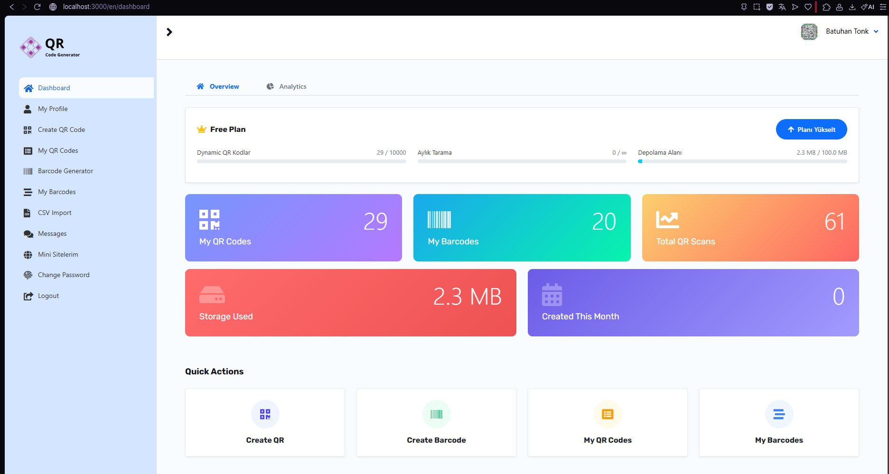
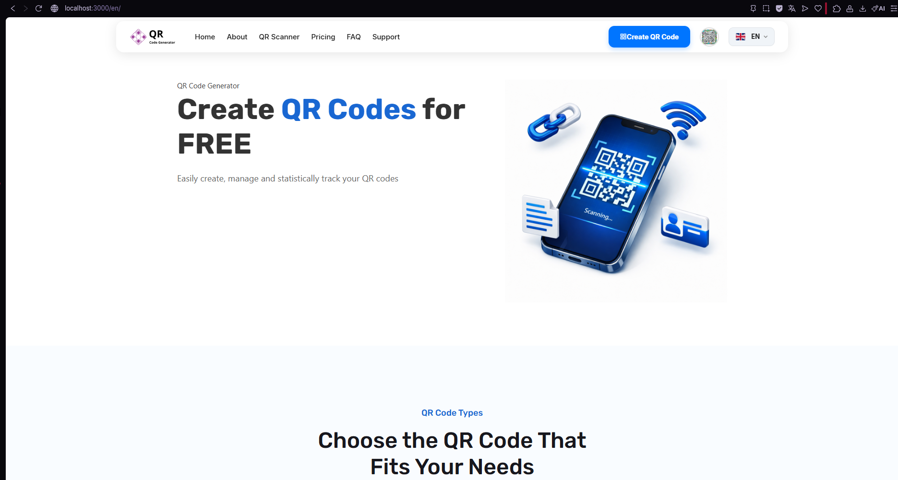
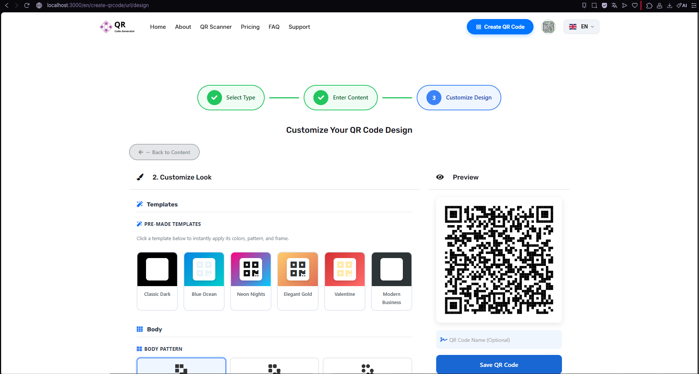
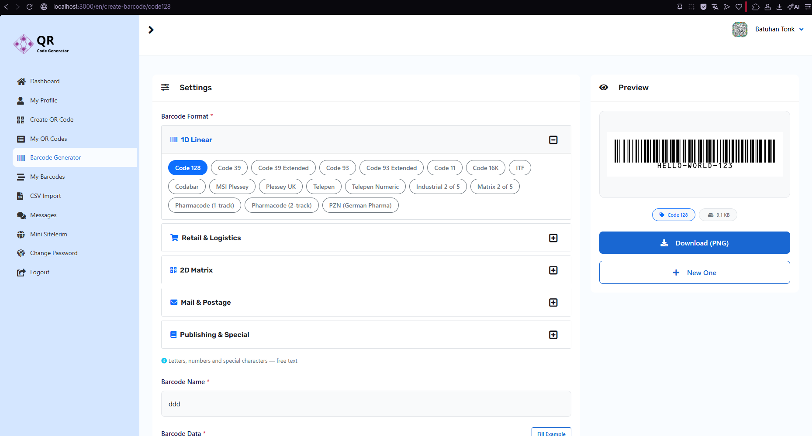
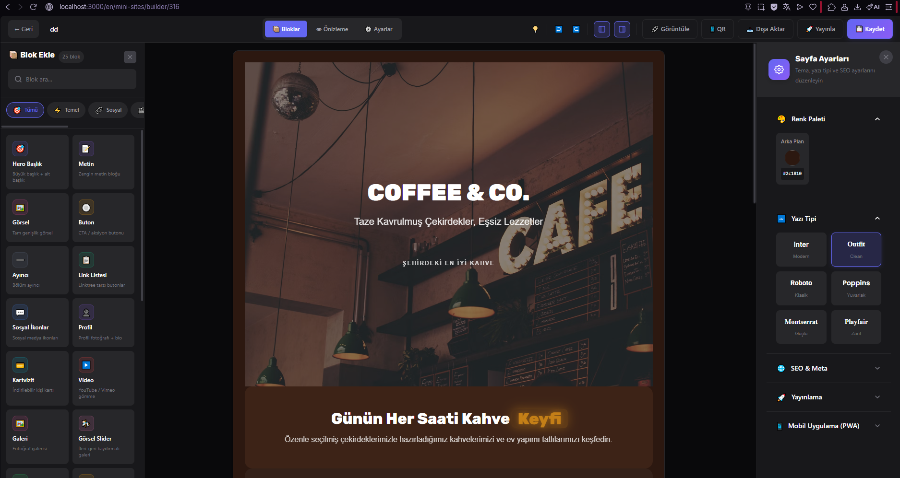
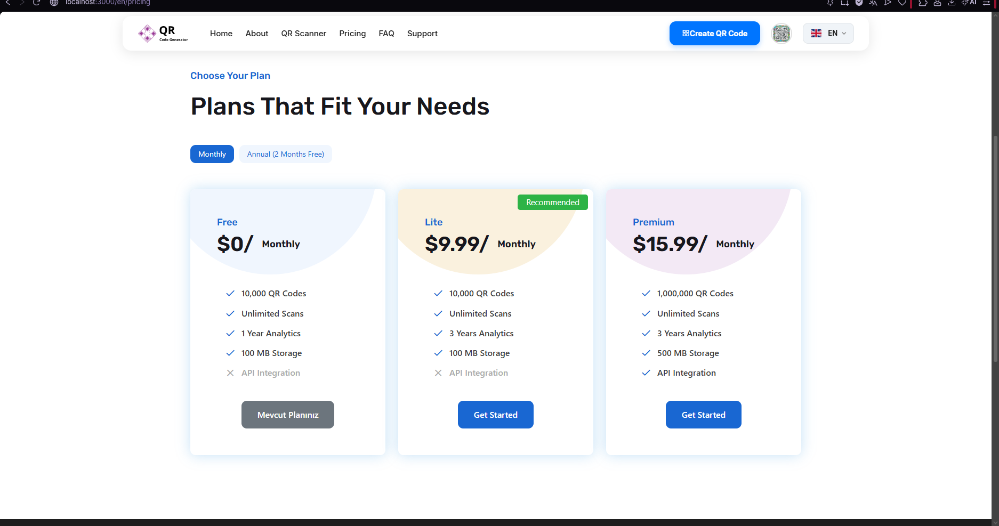

# Batuhan Tonk
### Full Stack & Mobile Developer

**Fikirden çalışan ürüne.**

React Native, Next.js ve TypeScript ile web ve mobil uygulamalar geliştiriyorum. 
Yapay zekâ entegrasyonlarını, kullanıcı deneyimini ve backend servislerini bir araya getiriyorum.

[**Portföy ↗**](https://batuhantnk.github.io) · [**LinkedIn ↗**](https://linkedin.com/in/batuhan-tonk-3b520a315) · [**İletişim ↗**](mailto:batuhan.tonk.1@gmail.com)

---

## Canlı projeler

| Proje | Neler sunuyor? | Keşfet |
| :--- | :--- | :--- |
| **GameSkinAI** | Fotoğraf ve konseptlerden oyun tarzı karakter görselleri ve prompt üretimi. | [Uygulamayı aç ↗](https://batuhantnk.github.io/GameSkinAI/) |
| **Yeşil Veteriner** | Klinik hizmetlerini ve hayvan otelini tanıtan, mobil uyumlu çok sayfalı web sitesi. | [Siteyi aç ↗](https://batuhantnk.github.io/yesil-veteriner/) |
| **Blok 2048** | Parça yerleştirme ve 2048 birleşmelerini birleştiren; farklı tahta boyutları ve yerel kayıt sunan tarayıcı oyunu. | [Oyunu oyna ↗](https://batuhantnk.github.io/blok2048/) |
| **Kişisel portföy** | Seçili çalışmalar, proje ekranları, yetenekler ve deneyim. Türkçe / İngilizce. | [Portföyü gez ↗](https://batuhantnk.github.io) |

## Seçili çalışmalar

<table>
<tr>
<td width="50%" valign="top">
<h3>GameSkinAI</h3>

Oyun tarzı karakter üretimi, prompt kütüphanesi, üretim geçmişi ve topluluk galerisi.

React · Vite · Supabase · Gemini · Edge Functions

<a href="https://batuhantnk.github.io/GameSkinAI/"><b>Canlı uygulama ↗</b></a> · <a href="https://github.com/BatuhanTNK/GameSkinAI">Kaynak kod</a>
</td>
<td width="50%" valign="top">
<h3>İlan Asistanı</h3>

Mülk bilgilerini üç farklı tonda ilan metnine dönüştüren AI destekli SaaS. Hesap yönetimi, ilan geçmişi ve kullanım kotası.

Next.js · TypeScript · Supabase · Gemini · Tailwind CSS

<a href="https://github.com/BatuhanTNK/real-estate-assistant"><b>Projeyi incele ↗</b></a>
</td>
</tr>
<tr>
<td width="50%" valign="top">
<h3>Click & Count</h3>

Sayaç, geri sayım ve kronometreyi; gruplar, hedefler, hatırlatıcılar ve kullanım istatistikleriyle birleştiren mobil uygulama.

React Native · Expo · TypeScript · Zustand

<a href="https://github.com/BatuhanTNK/click_count-"><b>Kaynak kod ↗</b></a> · Mobil proje / mağazada yayımlanmadı
</td>
<td width="50%" valign="top">
<h3>QR Code Uygulaması</h3>

Staj kapsamında geliştirdiğim QR kod ve barkod yönetim uygulaması. QR tasarım araçları, kullanım paneli ve mini site oluşturucu.

React · Node.js · Express · MySQL · Sequelize

<a href="#qr-code-galeri"><b>Ekran görüntülerini incele ↓</b></a> 
Staj projesi · Canlı yayında değil
</td>
</tr>
</table>

## QR Code galeri

**QR Code Uygulaması · Staj projesi · Canlı yayında değil**

QR kod oluşturma ve görsel özelleştirme, barkod üretimi, kullanıcı paneli, mini site editörü ve plan yönetiminden seçili ekranlar. Görsellere tıklayarak tam boyutta inceleyebilirsiniz.

<b>Uygulama ekranları (6 görsel)</b>

<table>
<tr>
<td width="50%"><b>Ana sayfa</b> </td>
<td width="50%"><b>Kullanıcı paneli</b> </td>
</tr>
<tr>
<td width="50%"><b>QR kod tasarım editörü</b> </td>
<td width="50%"><b>Barkod oluşturucu</b> </td>
</tr>
<tr>
<td width="50%"><b>Mini site oluşturucu</b> </td>
<td width="50%"><b>Planlar ve fiyatlandırma</b> </td>
</tr>
</table>

**Diğer çalışmalar:** Virtual Try-On (React Native ve fal.ai ile görsel deneme arayüzü) ve AR navigasyon (harita, konum sensörleri ve artırılmış gerçeklik).

[Tüm çalışmalar ve ekranlar ↗](https://batuhantnk.github.io/#/tr/deneyimler)

## Teknolojiler

| Alan | Kullandığım araçlar |
| :--- | :--- |
| **Web** | React · Next.js · TypeScript · JavaScript · Tailwind CSS |
| **Mobil** | React Native · Expo · Zustand |
| **Backend & veri** | Node.js · Express · PostgreSQL · MySQL · Supabase · Firebase |
| **AI & araçlar** | Gemini API · fal.ai · Git · Postman · Figma |

## Deneyim & eğitim

- **Full Stack Yazılım Geliştirici Stajyeri · KİM Bilişim** — Şubat - Haziran 2026  
  QR / barkod üretimi, analitik, toplu işlem ve ödeme entegrasyonu.
- **Mobil Uygulama Geliştirici Stajyeri · EDS Bilişim** — Temmuz - Ağustos 2025  
  AR destekli navigasyon, harita ve konum sensörü entegrasyonları.
- **Yazılım Mühendisliği · Burdur Mehmet Akif Ersoy Üniversitesi** — 2022 - 2026

---

**Bir sonraki projeyi birlikte geliştirelim.** 
Web, mobil ve yapay zekâ projeleri için iletişime geçebilirsiniz.

[Portföy](https://batuhantnk.github.io) · [LinkedIn](https://linkedin.com/in/batuhan-tonk-3b520a315) · [E-posta](mailto:batuhan.tonk.1@gmail.com)

Building web & mobile products with React, React Native and AI.

