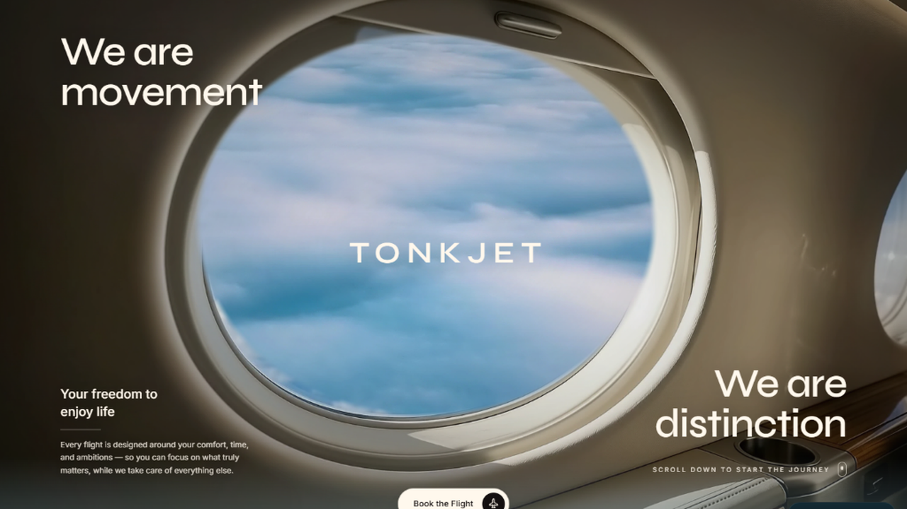
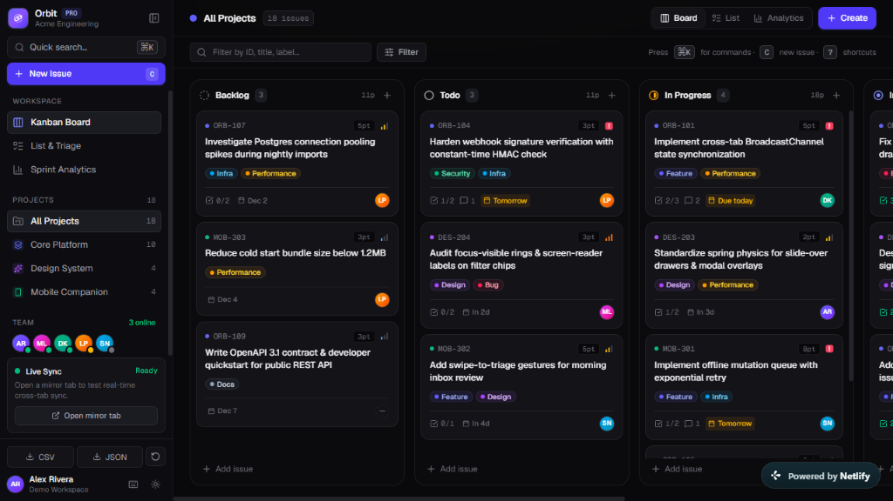
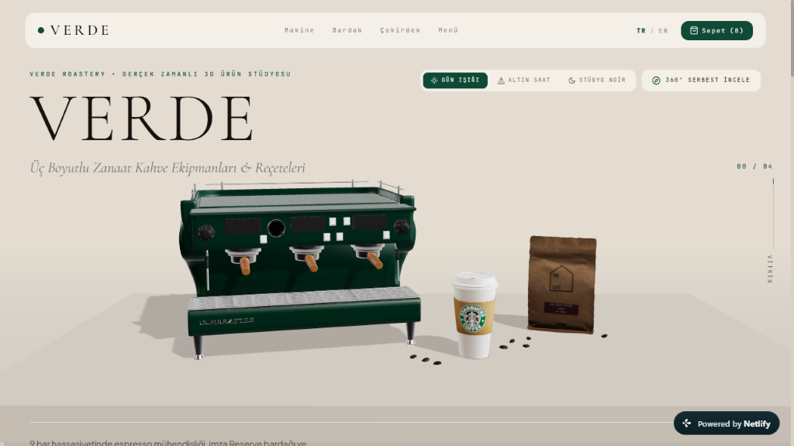
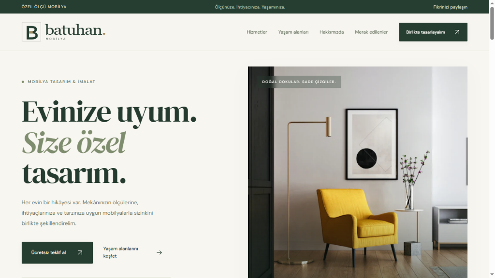
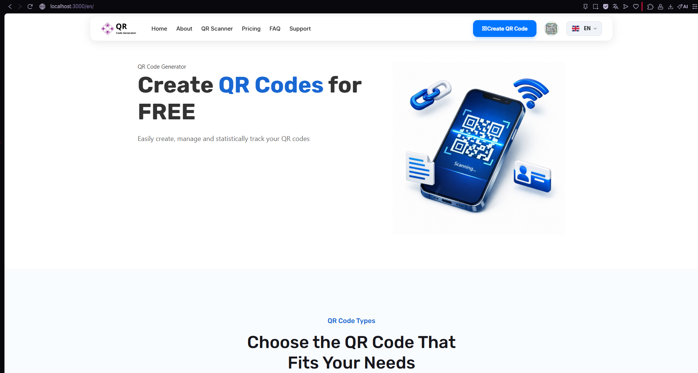
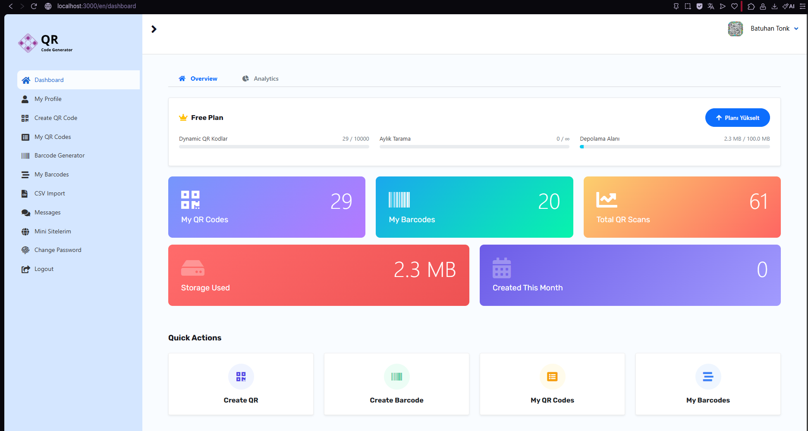
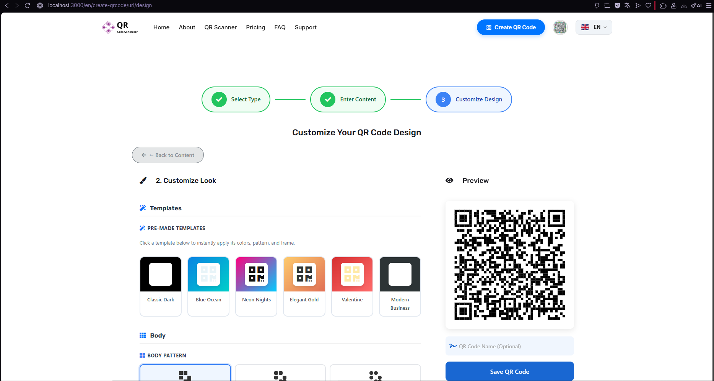
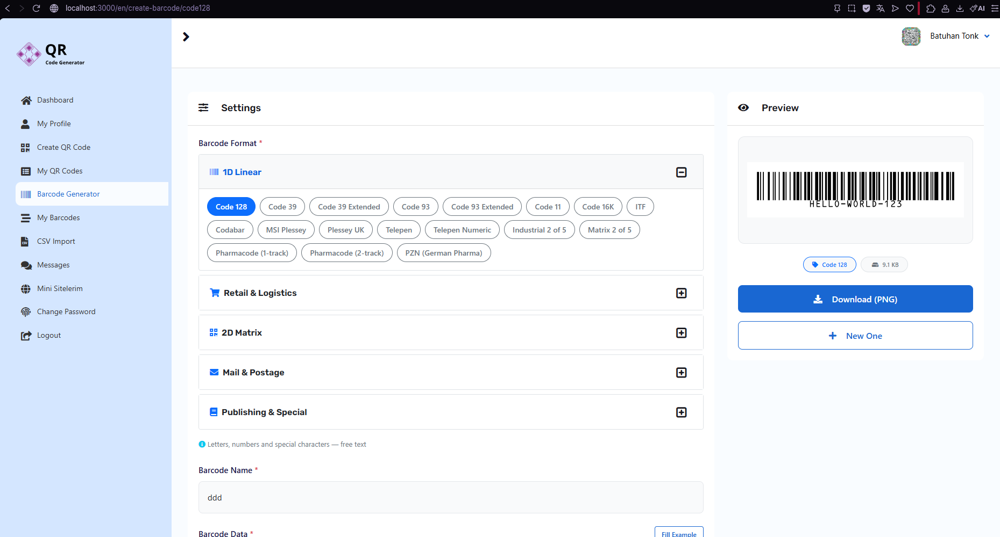
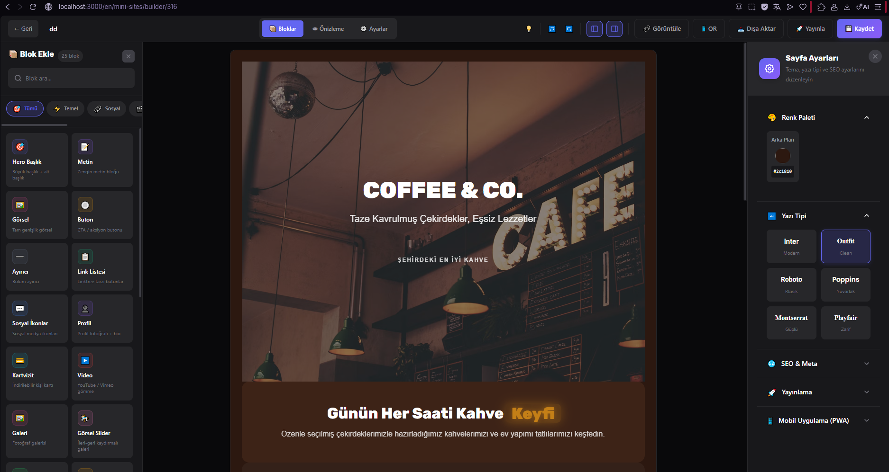
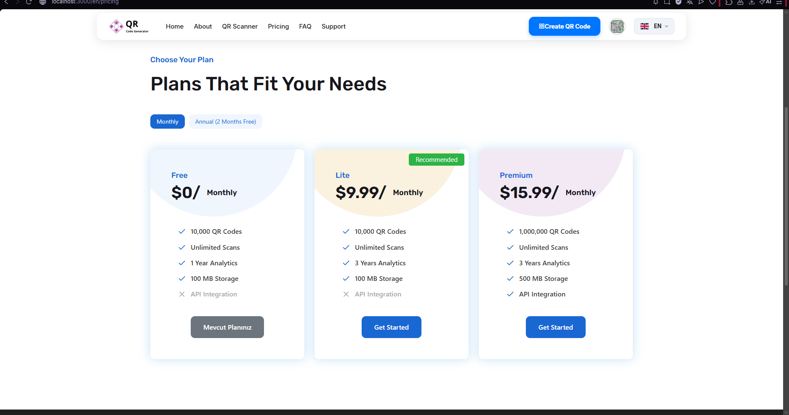

# Batuhan Tonk
### Full Stack & Mobile Developer

**Fikirden çalışan ürüne.**

Next.js, TypeScript, React Native ve Three.js ile web, mobil ve interaktif 3D uygulamalar geliştiriyorum. 
Yapay zekâ entegrasyonlarını, kullanıcı deneyimini ve backend servislerini bir araya getiriyorum.

[**Portföy ↗**](https://batuhantnk.github.io) · [**LinkedIn ↗**](https://linkedin.com/in/batuhan-tonk-3b520a315) · [**İletişim ↗**](mailto:batuhan.tonk.1@gmail.com)

---

## Canlı projeler

| Proje | Neler sunuyor? | Keşfet |
| :--- | :--- | :--- |
| **TonkJet** | 4K katmanlı kabin penceresi zoom geçişi, CSS maskeli uçak içi plan dönüşümü ve etkileşimli Three.js 3D uçuş ağı küresi sunan lüks özel jet kiralama deneyimi. | [Deneyimi aç ↗](https://tonkjet.netlify.app) |
| **Orbit Workspace** | Klavye odaklı proje ve görev yönetimi; Kanban panosu, sprint analitiği, `⌘K` komut paleti ve sekmeler arası canlı senkronizasyon. | [Uygulamayı aç ↗](https://orbit-workspace-batuhan.netlify.app) |
| **Verde Roastery 3D** | Three.js ve React Three Fiber ile gerçek zamanlı 3D kahve ekipmanları stüdyosu; canlı gövde rengi, ışık modu ve 360° kamera incelemesi. | [Deneyimi aç ↗](https://verde-roastery-3d.netlify.app) |
| **Batuhan Mobilya** | Özel ölçü mobilya tasarımı ve imalatı için modern, mobil uyumlu kurumsal vitrin ve teklif web sitesi. | [Siteyi aç ↗](https://batuhantnk.github.io/batuhan-mobilya/) |
| **GameSkinAI** | Fotoğraf ve konseptlerden oyun tarzı karakter görselleri ve prompt üretimi. | [Uygulamayı aç ↗](https://batuhantnk.github.io/GameSkinAI/) |
| **Yeşil Veteriner** | Klinik hizmetlerini ve hayvan otelini tanıtan, mobil uyumlu çok sayfalı web sitesi. | [Siteyi aç ↗](https://batuhantnk.github.io/yesil-veteriner/) |
| **Blok 2048** | Parça yerleştirme ve 2048 birleşmelerini birleştiren; farklı tahta boyutları ve yerel kayıt sunan tarayıcı oyunu. | [Oyunu oyna ↗](https://batuhantnk.github.io/blok2048/) |
| **Kişisel portföy** | Seçili çalışmalar, proje ekranları, yetenekler ve deneyim. Türkçe / İngilizce. | [Portföyü gez ↗](https://batuhantnk.github.io) |

## Seçili çalışmalar

<table>
<tr>
<td colspan="2" valign="top">
<h3>TonkJet — Private Jet Charter</h3>

Sinematik, kaydırma odaklı (scrollytelling) lüks özel jet kiralama deneyimi. 4K katmanlı şeffaf kabin penceresi zoom geçişi, Gulfstream 650ER dış görünümden kabin içi plana CSS maske dönüşümü, etkileşimli Three.js WebGL 3D uçuş ağı küresi, paralaks biniş kartı ve rezervasyon çekmecesi.

Next.js 14 · TypeScript · Tailwind CSS · Framer Motion · Three.js · Lenis · TopoJSON

<a href="https://tonkjet.netlify.app"><b>Canlı deneyim ↗</b></a> · <a href="https://github.com/BatuhanTNK/tonkjet">Kaynak kod</a>
</td>
</tr>
<tr>
<td width="50%" valign="top">
<h3>Orbit Workspace</h3>

Linear ilhamlı, klavye odaklı proje ve görev çalışma alanı. Sürükle-bırak Kanban panosu, sprint analitiği, ⌘K komut paleti ve BroadcastChannel canlı senkronizasyonu.

Next.js · TypeScript · Tailwind CSS · Zustand · dnd-kit · Recharts

<a href="https://orbit-workspace-batuhan.netlify.app"><b>Canlı uygulama ↗</b></a> · <a href="https://github.com/BatuhanTNK/orbit-workspace">Kaynak kod</a>
</td>
<td width="50%" valign="top">
<h3>Verde Roastery 3D</h3>

Gerçek zamanlı 3D kahve ekipmanları stüdyosu. Etkileşimli 3D modeller, canlı gövde rengi ve ışık modu geçişleri, 360° kamera kontrolü ve TR/EN arayüz.

React · Three.js · React Three Fiber · Lenis · Tailwind CSS · Vite

<a href="https://verde-roastery-3d.netlify.app"><b>Canlı deneyim ↗</b></a> · <a href="https://github.com/BatuhanTNK/verde-roastery-3d">Kaynak kod</a>
</td>
</tr>
<tr>
<td width="50%" valign="top">
<h3>Batuhan Mobilya</h3>

Özel ölçü mobilya tasarımı ve imalatı için hazırlanmış modern, mobil uyumlu kurumsal vitrin, yaşam alanları seçkisi ve teklif talep akışı.

HTML · CSS · JavaScript · SEO · Responsive Design

<a href="https://batuhantnk.github.io/batuhan-mobilya/"><b>Canlı site ↗</b></a> · Kurumsal vitrin sitesi
</td>
<td width="50%" valign="top">
<h3>GameSkinAI</h3>

Oyun tarzı karakter üretimi, prompt kütüphanesi, üretim geçmişi ve topluluk galerisi.

React · Vite · Supabase · Gemini · Edge Functions

<a href="https://batuhantnk.github.io/GameSkinAI/"><b>Canlı uygulama ↗</b></a> · <a href="https://github.com/BatuhanTNK/GameSkinAI">Kaynak kod</a>
</td>
</tr>
<tr>
<td width="50%" valign="top">
<h3>İlan Asistanı</h3>

Mülk bilgilerini üç farklı tonda ilan metnine dönüştüren AI destekli SaaS. Hesap yönetimi, ilan geçmişi ve kullanım kotası.

Next.js · TypeScript · Supabase · Gemini · Tailwind CSS

<a href="https://github.com/BatuhanTNK/real-estate-assistant"><b>Projeyi incele ↗</b></a>
</td>
<td width="50%" valign="top">
<h3>Click & Count</h3>

Sayaç, geri sayım ve kronometreyi; gruplar, hedefler, hatırlatıcılar ve kullanım istatistikleriyle birleştiren mobil uygulama.

React Native · Expo · TypeScript · Zustand

<a href="https://github.com/BatuhanTNK/click_count-"><b>Kaynak kod ↗</b></a> · Mobil proje / mağazada yayımlanmadı
</td>
</tr>
</table>

## QR Code galeri

**QR Code Uygulaması · Staj projesi · Canlı yayında değil**

Staj kapsamında geliştirdiğim QR kod ve barkod yönetim uygulaması. QR kod oluşturma ve görsel özelleştirme, barkod üretimi, kullanıcı paneli, mini site editörü ve plan yönetiminden seçili ekranlar. Görsellere tıklayarak tam boyutta inceleyebilirsiniz.

React · Node.js · Express · MySQL · Sequelize

<b>Uygulama ekranları (6 görsel)</b>

<table>
<tr>
<td width="50%"><b>Ana sayfa</b> </td>
<td width="50%"><b>Kullanıcı paneli</b> </td>
</tr>
<tr>
<td width="50%"><b>QR kod tasarım editörü</b> </td>
<td width="50%"><b>Barkod oluşturucu</b> </td>
</tr>
<tr>
<td width="50%"><b>Mini site oluşturucu</b> </td>
<td width="50%"><b>Planlar ve fiyatlandırma</b> </td>
</tr>
</table>

**Diğer çalışmalar:** Virtual Try-On (React Native ve fal.ai ile görsel deneme arayüzü) ve AR navigasyon (harita, konum sensörleri ve artırılmış gerçeklik).

[Tüm çalışmalar ve ekranlar ↗](https://batuhantnk.github.io/#/tr/deneyimler)

## Teknolojiler

| Alan | Kullandığım araçlar |
| :--- | :--- |
| **Web & 3D** | React · Next.js · TypeScript · JavaScript · Tailwind CSS · Three.js · React Three Fiber |
| **Mobil** | React Native · Expo · Zustand |
| **Backend & veri** | Node.js · Express · PostgreSQL · MySQL · Supabase · Firebase |
| **AI & araçlar** | Gemini API · fal.ai · Git · Netlify · Postman · Figma |

## Deneyim & eğitim

- **Full Stack Yazılım Geliştirici Stajyeri · KİM Bilişim** — Şubat - Haziran 2026
  QR / barkod üretimi, analitik, toplu işlem ve ödeme entegrasyonu.
- **Mobil Uygulama Geliştirici Stajyeri · EDS Bilişim** — Temmuz - Ağustos 2025
  AR destekli navigasyon, harita ve konum sensörü entegrasyonları.
- **Yazılım Mühendisliği · Burdur Mehmet Akif Ersoy Üniversitesi** — 2022 - 2026

---

**Bir sonraki projeyi birlikte geliştirelim.** 
Web, 3D, mobil ve yapay zekâ projeleri için iletişime geçebilirsiniz.

[Portföy](https://batuhantnk.github.io) · [LinkedIn](https://linkedin.com/in/batuhan-tonk-3b520a315) · [E-posta](mailto:batuhan.tonk.1@gmail.com)

Building web, 3D & mobile products with Next.js, React Native, Three.js and AI.

